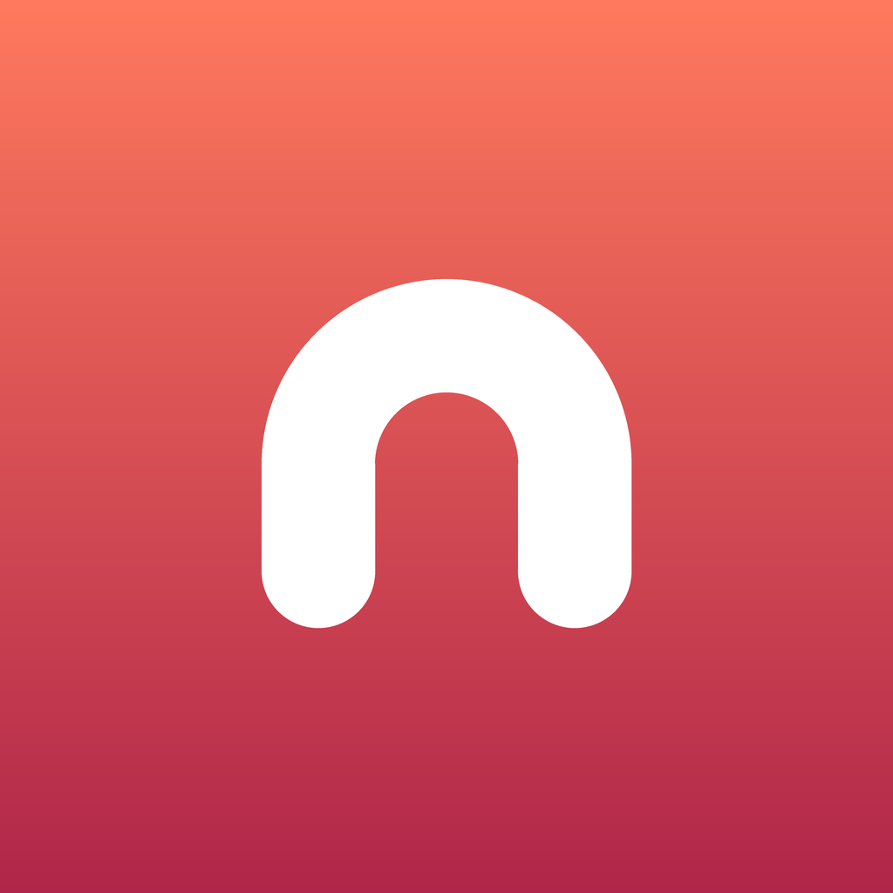

<div align="center">



# Nive

**A free, ad-free music player for iPhone and Mac, powered by YouTube Music.**

Search anything, blend songs like a DJ with AutoMix, read synced lyrics, and keep your music offline.

iPhone (iOS 26+) · Mac (Apple Silicon, macOS 15+) · SwiftUI · GPL-3.0

</div>

---

## Features

**Listen**
- Search songs, artists, albums, movie soundtracks and playlists, with live suggestions as you type
- Filters: All · Songs · Albums · Artists · Videos · Playlists, with a big top result you can play in one tap
- Album, artist and playlist pages; search a movie name to get its full soundtrack
- Screen-off playback with lock screen and Dynamic Island controls
- Repeat (all / one) and shuffle

**AutoMix**
- Songs blend into each other at the end instead of stopping
- Detects each song's tempo and beats; when tempos are close it gently matches them and lines up the beats
- Bass swap mid-blend so two kick drums never clash, and silent intros and outros are skipped
- Falls back to a smooth crossfade when a song has no clear beat
- An **AutoMix** badge shows while a blend is playing

**Discover**
- **Home:** Quick picks built from what you play and like, "Because you liked…", Recently played, plus YouTube Music's home
- **Explore:** new releases, charts, and moods & genres
- **Up Next** keeps going with YouTube's own Mix for the current song
- **Not Interested** (swipe in Up Next, 👎 in the player, or the ⋯ menu) hides a song everywhere, for good

**Lyrics**
- Word-synced lyrics from Apple Music, Spotify and Deezer via LyricsPlus, with LRCLIB as fallback
- Tap a line to jump there
- Non-Latin lyrics (Tamil, Hindi, Telugu, Korean…) can be shown in English letters
- "Search Lyrics" when a song's name on YouTube doesn't match

**Shortcuts & Siri**
- Actions for the Shortcuts app: Play Liked Songs, Play a Playlist, Play a Song, Play / Pause, Next / Previous, Set AutoMix
- Use them in automations ("every morning at 8, play my liked songs"), on the Home Screen, or with Siri

**Library**
- Liked songs, your own playlists (rename, reorder, remove songs, delete), downloads for offline listening, recently played
- Optional Google sign-in for your personal YouTube Music home (Nive works fully without it)

## Install on Mac

Download **`Nive-<version>.dmg`** from the [latest release](https://github.com/Nagashreeshyl/nive/releases/latest), drag Nive into Applications, and allow it once in **System Settings → Privacy & Security → Open Anyway**. The Mac app never expires. Details and keyboard shortcuts: **[docs/INSTALL-MAC.md](docs/INSTALL-MAC.md)**.

The Mac app has the same features in a Mac layout: a sidebar, a player bar, a lyrics / Up Next side panel, media keys and shortcuts.

## Install on iPhone (free)

Nive isn't on the App Store. You install it with **[SideStore](https://sidestore.io)** using a free Apple ID, and SideStore keeps it signed.

Short version:
1. Install **LocalDevVPN** from the App Store and **SideStore** with [iloader](https://docs.sidestore.io/docs/installation/prerequisites) on your computer.
2. In SideStore → **Sources → +**, add:
   ```
   https://raw.githubusercontent.com/Nagashreeshyl/nive/main/altstore.json
   ```
3. Install **Nive** from that source. New versions show up there as **Update**.

Step-by-step guide, weekly refresh and troubleshooting: **[docs/INSTALL.md](docs/INSTALL.md)**.

## How it works

Nive talks to YouTube Music's internal API for search, pages and recommendations, and resolves playable audio streams with [SwiftyTube](https://github.com/SwiftyMedia/SwiftyTube). Songs are fetched in parallel chunks, kept compressed in a local cache, beat-analysed once, and played through a two-deck `AVAudioEngine` mixer that performs AutoMix. Details: **[docs/ARCHITECTURE.md](docs/ARCHITECTURE.md)**.

Nothing is sent anywhere except YouTube, the lyrics services and Google's search suggestions. There's no account, analytics or tracking.

## Build from source

Requires Xcode 26+ and [XcodeGen](https://github.com/yonaskolb/XcodeGen) (`brew install xcodegen`).

```bash
git clone https://github.com/Nagashreeshyl/nive.git
cd nive
xcodegen generate
open Nive.xcodeproj            # run on a simulator or your device
./build_ipa.sh 0.2.0           # unsigned build/Nive.ipa for SideStore
./build_dmg.sh 0.2.0           # build/Nive-0.2.0.dmg for Mac
```

Tests:

```bash
xcodebuild test -project Nive.xcodeproj -scheme Nive -destination 'platform=iOS Simulator,name=iPhone 17'
```

Publishing a new version: **[docs/RELEASING.md](docs/RELEASING.md)**.

## FAQ

**Do I need YouTube Premium?** No. Nive plays without ads whether or not you have Premium, and it keeps working after Premium ends.

**Playback stopped working.** YouTube changes things from time to time. The fix is usually an update to the streaming engine (SwiftyTube) and a new release. Check for an update in SideStore.

**Nive won't open.** The 7-day signature expired. Connect LocalDevVPN, open SideStore, tap **Refresh All**.

## Credits

- [Mochy-Music](https://github.com/realidkroo/Mochy-Music), the Android app that inspired Nive
- [SwiftyTube](https://github.com/SwiftyMedia/SwiftyTube) and [Trop](https://github.com/SwiftyMedia/Trop), the InnerTube and stream resolution engine and reference client
- [LyricsPlus](https://github.com/ibratabian17/LyricsPlus) and [LRCLIB](https://lrclib.net), lyrics
- [SideStore](https://sidestore.io), sideloading

## Disclaimer

Nive is an independent, unofficial project for personal and educational use. It is not affiliated with, endorsed by, or connected to YouTube, Google, Apple or any music service. Please support the artists you listen to.

## License

[GPL-3.0](LICENSE)
